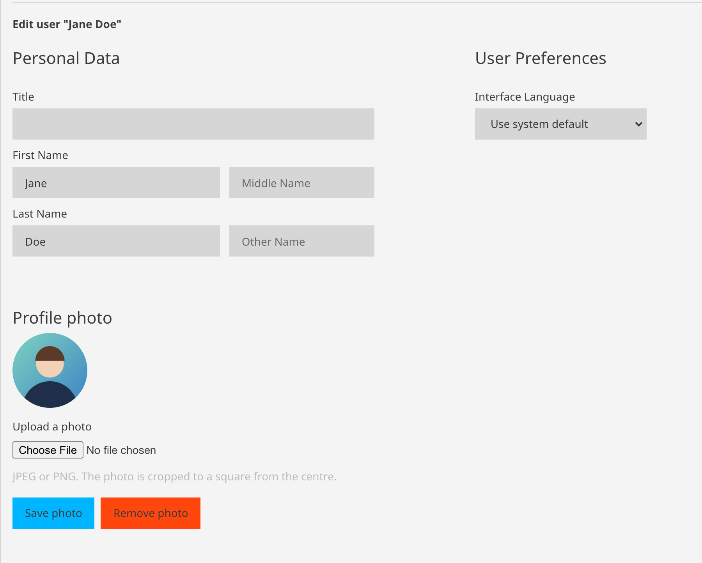
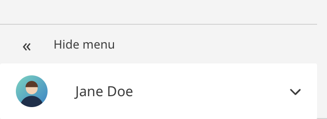
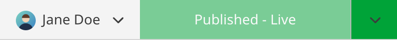

# UpAssist Neos User Avatar

A profile photo for Neos backend users. The photo replaces the initials (Neos 9, in the drawer
at the bottom left) or the user icon (Neos 8, top right) in the user menu of the Neos UI and of
the backend modules.

- Every editor uploads their own photo on the **User Settings** page, in a "Profile photo" block.
- Optionally, users without an uploaded photo get their [Gravatar](https://gravatar.com).
- Without a photo, Neos shows the initials or icon as before.



| Neos 9: user menu at the bottom left | Neos 8: user menu at the top right |
| --- | --- |
|  |  |

## Compatibility

| Version | Neos |
| --- | --- |
| unreleased | 8.3, 8.4, 9.0, 9.1, 9.2 |

## Installation

```bash
composer require upassist/neos-useravatar
```

No database migration is needed.

## Configuration

```yaml
UpAssist:
  Neos:
    UserAvatar:
      size: 256                    # width and height of the stored photo, in pixels
      maximumUploadSize: 10485760  # bytes
      gravatar:
        enabled: false
        default: '404'             # '404' keeps the Neos initials; or 'mp', 'identicon', ...
        rating: 'g'
```

### Gravatar

Gravatar is off by default. With `gravatar.enabled: true`, a user without an uploaded photo gets
the Gravatar of an e-mail address of their user, in this order: the primary electronic address
(when it is an e-mail address), the first other e-mail address, the account name (when it is an
e-mail address). The hash is SHA-256.

The browser of the editor then loads the photo from gravatar.com, so Gravatar (Automattic) sees
the editor's IP address and the hash of the e-mail address. Decide whether that is acceptable
for your editors before you enable it.

## Permissions

### Who can set a photo

Every user who is logged in to the Neos backend, whatever their role. That includes custom roles
that do not extend `Neos.Neos:AbstractEditor`, for example a role that only gets a few backend
modules plus User Settings.

The package defines one privilege target and grants it to `Neos.Flow:AuthenticatedUser`:

| Privilege target | Type | Covers |
| --- | --- | --- |
| `UpAssist.Neos.UserAvatar:Own` | `MethodPrivilege` | All four actions of `AvatarController`: `show`, `settings`, `upload`, `remove` |

Where the photo block appears follows from Neos' own privileges: it is added to the User Settings
page, so only roles that may open that page (`Neos.Neos:Backend.Module.User.UserSettings`) see it.
The photo in the user menu shows for every backend user who has one.

### What a user can do

- Only their own photo. No action takes a user as argument: the controller resolves the user from
  the account of the `Neos.Neos:Backend` authentication provider. A user cannot see, replace or
  remove another user's photo.
- An account of another provider (a frontend login, for example) gets no photo: `show` and
  `settings` answer 404, `upload` and `remove` answer 403.
- `upload` and `remove` accept only POST with the CSRF token of the backend page; a request
  without the token gets 403 from Flow.
- The photo identifier in the user's preferences is not trusted: users can set their own
  preferences through the Neos API. The package only serves or deletes a resource from its own
  collection whose file name carries that user's identifier.

### Taking it away from a role

A DENY wins over the grant. In your own `Policy.yaml`:

```yaml
roles:
  'Your.Package:SomeRole':
    privileges:
      -
        privilegeTarget: 'UpAssist.Neos.UserAvatar:Own'
        permission: DENY
```

Users with that role then keep the initials or icon, and the block does not appear on their User
Settings page.

## How it works

- Uploads are JPEG or PNG (GIF and WebP can hold many frames), at most 10 MB and 40 megapixels.
- The uploaded photo is cropped to a square from the centre, rotated by its EXIF orientation and
  stored as a Flow resource in its own collection, `upassistUserAvatar` (same storage and target
  as `persistent`). It is not a Media asset, so it does not show up in the Media module. Its
  identifier is stored in the user's preferences (`UpAssist.Neos.UserAvatar.resource`).
- `GET /neos/user-avatar` answers for the logged-in backend user: a redirect to the uploaded
  photo, else to Gravatar (when enabled), else 404. `GET /neos/user-avatar/settings` gives the
  data for the photo block as JSON; `POST /neos/user-avatar/upload` and `/remove` change the
  photo (CSRF token required) and return to User Settings, where Neos shows the result as a
  flash message.
- The photo block on User Settings is added by the script that every backend module loads
  (`Neos.Neos.moduleConfiguration.additionalResources`). Its controls belong to a form of their
  own outside the Neos user form, so the Neos template is not overridden and "Save User" works
  as before.
- In the Neos UI, a plugin wraps the user menu container (`Drawer/Bottom/UserDropDown` in Neos 9,
  `PrimaryToolbar/Right/UserDropDown` in Neos 8). The Neos component stays in place, so logout,
  user settings and "restore user" keep working. In the backend modules a small script does the
  same for the Fluid user menu.

## Development

The Neos UI plugin is built with esbuild as described in the
[Neos UI extensibility guideline](https://github.com/neos/neos-ui/blob/9.2/packages/neos-ui-extensibility/README.md).
One build serves Neos UI 8.3 up to 9.x. The built `Resources/Public/Plugin/Plugin.js` and
`Plugin.css` are committed, so installing the package needs no Node.

```bash
cd Resources/Private/Scripts
yarn install --frozen-lockfile
yarn build   # or: yarn watch
```

Commit the rebuilt files in `Resources/Public` together with the source change; CI checks that
they match.

## License

MIT
